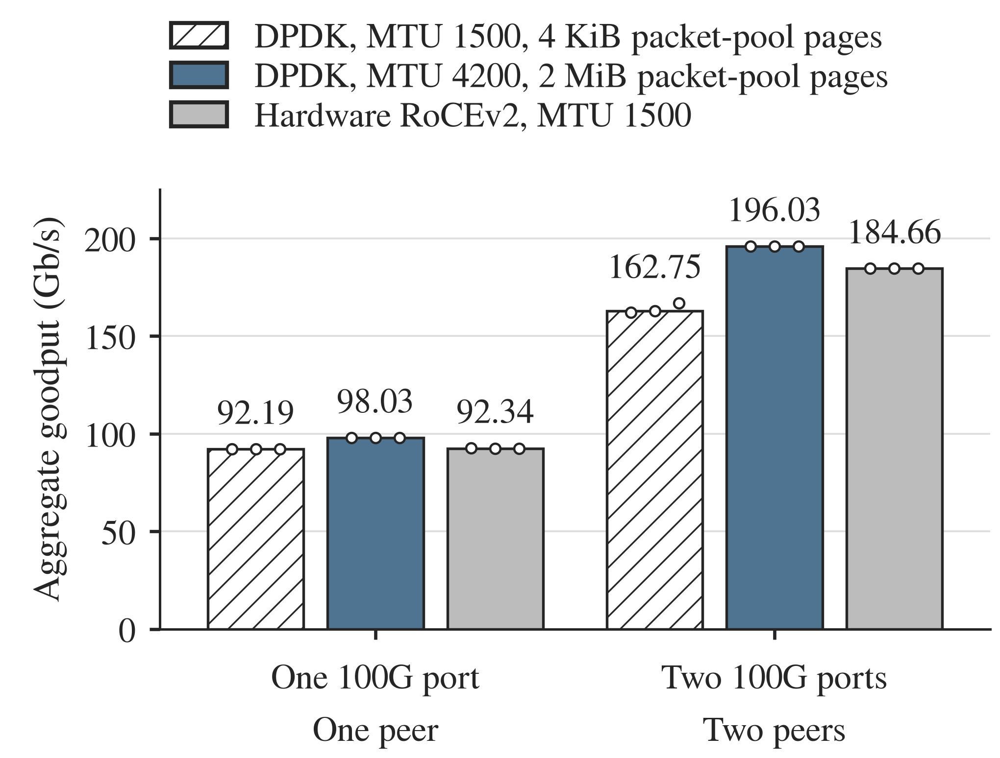
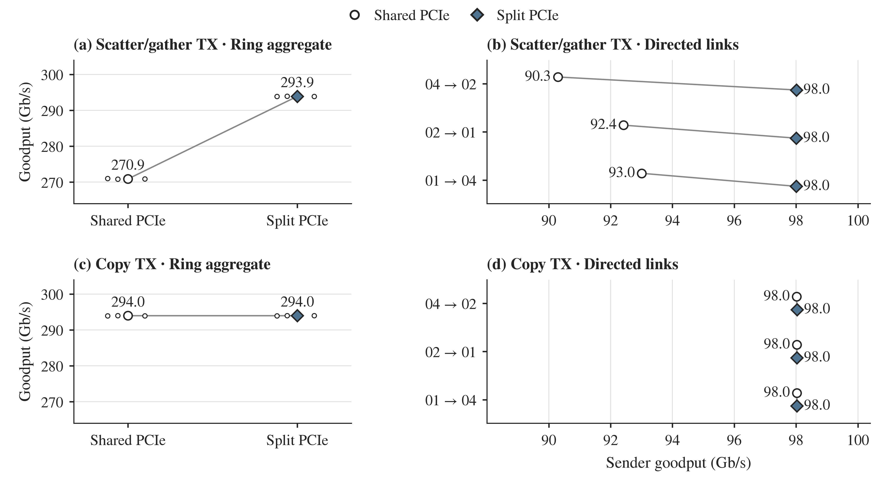
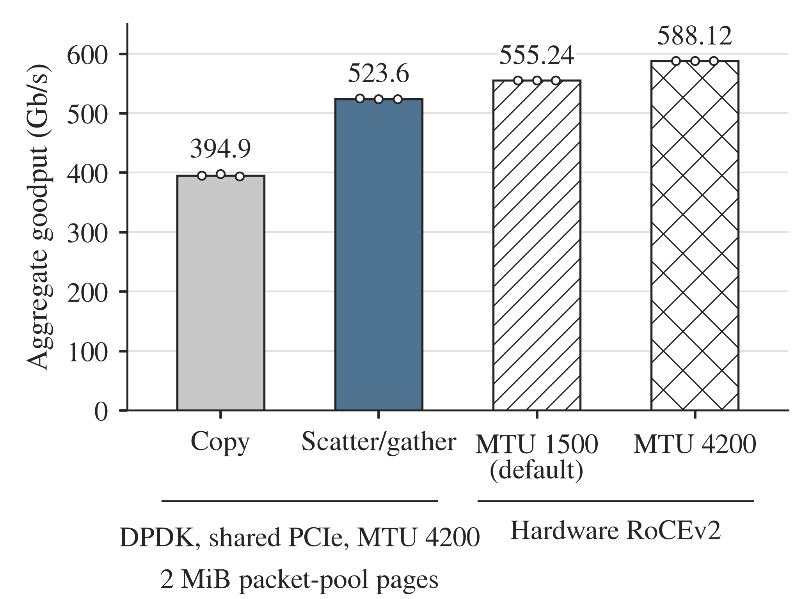

# Spark RoCEv2 benchmark results

All rates are **payload Gb/s**, using the median of three trials. Each number links to its measurements. A dash marks a configuration without a result in this comparison.

| Physical setup | Traffic | DPDK TX mode | DPDK MTU 1500 | DPDK MTU 4200 + 2 MiB pages | Hardware MTU 1500 |
|---|---|---|---:|---:|---:|
| One 100G link, one PCIe path | One-way | Standalone copy | [90.51][copy-one] | — | [92.32][hw-link] |
| One 100G link, one PCIe path | One-way | Application scatter/gather | [84.94][sg-standard] | [98.03][sg-jumbo] | [92.32][hw-link] |
| One 100G link, both PCIe paths | One-way | Standalone copy | [92.57][copy-both] | — | [92.34][hw-link] |
| One 100G link, both PCIe paths | One-way | Application scatter/gather | [92.19][sg-both] | [98.03][sg-both-jumbo] | [92.34][hw-link] |
| Two 100G links from Spark-04 | One sender → two peers | Application scatter/gather | [162.75][two-standard] | [**196.03**][two-jumbo] | [184.66][hw-two] |
| Three 100G links, shared PCIe | One-way around ring | Standalone copy | [83.79–84.25 per edge][ring-standard] | [**293.9**][ring-copy] | — |
| Three 100G links, shared PCIe | One-way around ring | Standalone copy TX, application RX | — | [294.0][copy-tx-shared] | — |
| Three 100G links, split PCIe | One-way around ring | Standalone copy TX, application RX | — | [294.0][copy-tx-split] | — |
| Three 100G links, shared PCIe | One-way around ring | Application scatter/gather | — | [270.9][ring-sg-shared] / [275.9 rerun][ring-sg-repeat] | — |
| Three 100G links, split PCIe | One-way around ring | Application scatter/gather | — | [**293.9**][ring-sg-split] | — |
| Three 100G links, shared PCIe | Full duplex around ring | Standalone copy | — | [394.9][duplex-copy-shared] | [555.24][hw-ring] |
| Three 100G links, split PCIe | Full duplex around ring | Standalone copy | — | [320.0][duplex-copy-split] | — |
| Three 100G links, shared PCIe | Full duplex around ring | Application scatter/gather | — | [**523.6**][duplex-sg-shared] | [**555.24**][hw-ring] |
| Three 100G links, split PCIe | Full duplex around ring | Application scatter/gather | — | [314.9][duplex-sg-split] | — |
| Three 100G links, one PCIe domain per peer | Full duplex around ring | Application scatter/gather | — | [**523.2**][duplex-sg-peer] | — |
| Four 100G links, one PCIe domain per peer | Full duplex around ring | Application scatter/gather | — | [**697.4** whole batch][four-sg-raw] / [**715.5** all senders active][four-sg-rates] | — |

The one-link runs connect Spark-04 to Spark-02. Both PCIe paths on that connection share one physical QSFP link. In the two-port run, Spark-04 sends to Spark-02 and Spark-01 simultaneously. Ethernet MTUs 1500 and 4200 correspond to RoCE path MTUs 1024 and 4096. The DPDK rates time the transfer and exclude setup and subsequent byte verification.

With both PCIe paths sharing one 100G cable, the jumbo scatter/gather trials delivered 98.030, 98.031, 98.030 Gb/s. Each trial verified 16 GiB per path. The aggregate uses 32 GiB over the interval from the earliest sender start to the latest sender finish. The three trials recorded 0 requester retries and 0 NIC misses across both paths. [Trial records][sg-both-jumbo] · [Endpoint and hugepage logs](spark-04-to-02/same-cable-jumbo/endpoints.tar.gz) · [Runner and service configuration](spark-04-to-02/same-cable-jumbo/runner.tar.gz)

## Figures

The following settings stayed fixed across the DPDK runs in all three figures.

- **Workers and queues.** Each active directed path used four polling workers at the sender and four at the receiver, with 16 queue pairs per path. Spark-04 therefore used eight TX polling workers in both groups of the paired bar plot.
- **Workload.** Each queue pair issued 1,024 host-memory RC WRITEs of 1 MiB each. Each receiver verified 16 GiB per directed path per trial.
- **Packet submission.** Each sender used a TX burst of up to 16 packets per submission and a send window of 256 outstanding packets per queue pair.
- **Repetitions.** Each configuration ran three times. The DPDK plots use sender-side payload goodput. Ring aggregate whiskers show the bounds from timing the transfers on different hosts.



**Figure 1. One-way goodput from Spark-04 over two PCIe paths.** The paths share one 100 Gb/s cable to Spark-02 or use separate 100 Gb/s cables to Spark-02 and Spark-01. Bars show median aggregate payload goodput over three trials. Circles show individual trials. The two DPDK bars in each group use application-backed scatter/gather and verify 32 GiB per trial. They pair Ethernet MTU 1500 with 4 KiB packet-pool pages and MTU 4200 with 2 MiB packet-pool pages. The third bar in each group shows hardware RoCEv2 at the default Ethernet MTU of 1500, measured with native perftest. [One-cable hardware][hw-link] · [Two-cable hardware][hw-two] · [Vector PDF](figures/one-way-ports.pdf) · [One cable at MTU 1500][sg-both] · [One cable at MTU 4200][sg-both-jumbo] · [Two ports at MTU 1500][two-standard] · [Two ports at MTU 4200][two-jumbo]



**Figure 2. One-way ring goodput by TX mode and receive PCIe placement.** Moving RX from PCIe domain 0 to domain 2 raised aggregate scatter/gather goodput from 270.9 to 293.9 Gb/s on November 25. Copy TX reached 294.0 Gb/s at both placements. TX stayed on domain 0. All configurations used the same application-backed receiver build, CPU pinning and MTU 4200. The sender was application-backed scatter/gather (`8c5058a`) or standalone copy (`a2c307f`). Panels (a) and (c) show the midpoint of the median aggregate bounds. Small circles and whiskers give each trial’s midpoint and timing bounds. Panels (b) and (d) show median sender goodput for each link over the same three trials. [Vector PDF](figures/one-way-ring-pcie.pdf) · [Shared scatter/gather][ring-sg-shared] · [Split scatter/gather][ring-sg-split] · [Shared copy TX][copy-tx-shared] · [Split copy TX][copy-tx-split]



**Figure 3. Full-duplex goodput on a three-link 100 Gb/s ring.** All six directions carried traffic concurrently. Both DPDK runs used shared PCIe. Each Spark used one PCIe domain for clockwise TX and RX and the other for counterclockwise TX and RX. DPDK used Ethernet MTU 4200, RoCE path MTU 4096 and 2 MiB packet-pool pages. Standalone copy (`a2c307f`) and application-backed scatter/gather (`8c5058a`) each verified 96 GiB per trial. DPDK bars show the midpoint of the median aggregate timing bounds. The three markers per bar show individual trials, with whiskers for the DPDK timing bounds. Hardware bars show median aggregate goodput at the default Ethernet MTU of 1500 and at MTU 4200 (RoCE path MTUs 1024 and 4096). Hardware perftest used one QP per PCIe path, 1 MiB RC WRITEs and 10-second sampling windows. [Vector PDF](figures/full-duplex-ring.pdf) · [DPDK copy][duplex-copy-shared] · [DPDK scatter/gather][duplex-sg-shared] · [Hardware MTU 1500][hw-ring] · [Hardware MTU 4200][hw-ring-jumbo]

Figures 1 and 3 are sized for a 3.4-inch column. Figure 2 spans 7 inches. The PDFs contain vector graphics and embedded fonts. Run `python3 figures/plot_results.py` from this directory with Matplotlib installed to regenerate the PDFs and 600 dpi PNGs from the archived measurements.

## TX mode and PCIe placement

- **TX mode.** Use the application sender’s scatter/gather default for application-backed buffers and the standalone sender’s copy default for standalone runs. The physical ring measurements used builds `8c5058a` and `a2c307f`, respectively. The November 25 full-duplex increase of 33.4% from 392.3 to 523.3 Gb/s compares those two builds and application setups. The later configurable sender passed both modes over memif. A same-build physical comparison remains open. [TX mode selection](../README.md#application-owned-buffers)
- **One-way ring.** On the same scatter/gather build, moving RX from PCIe domain `0000` to `0002` raised aggregate goodput by 23.0 Gb/s. TX stayed on `0000` and CPU assignments stayed fixed on all three hosts. With the same application-backed receivers, standalone copy TX reached 294.0 Gb/s at both placements. The earlier all-standalone shared-PCIe control reached 293.9 Gb/s. [Shared copy TX][copy-tx-shared] · [Split copy TX][copy-tx-split] [Shared scatter/gather][ring-sg-shared] · [Split scatter/gather][ring-sg-split] · [Shared copy][ring-copy]
- **Two-port jumbo run.** Raising Ethernet MTU and switching the packet pools to 2 MiB pages together took Spark-04 from 162.75 to 196.03 Gb/s. Both receivers verified 16 GiB in each jumbo trial with zero retries or RX misses. A separate single-link test held MTU 4200 fixed. With 2 MiB packet-pool pages, Spark-04 sent to Spark-02 at a median of **98.012 Gb/s**, and the receiver verified 16 GiB in each of three trials with zero requester retries. Both 4 KiB attempts exhausted retries after mlx5 RX errors. [Page-backing experiment](../CONFORMANCE.md#spark-04-to-spark-02-jumbo-page-backing)

### Full-duplex PCIe placement

The November 27 comparison used the same worker pinning, physical cables, peers and DPDK build for the shared and split placements within each TX mode. All three Sparks negotiated Gen5 ×4 on both PCIe domains. Splitting the payload paths reduced aggregate goodput by 19.0% for copy and 39.9% for scatter/gather relative to their shared controls.

| Per-Spark PCIe placement | Standalone copy (Gb/s) | Application scatter/gather (Gb/s) |
|---|---:|---:|
| Clockwise TX/RX on PCIe0, counterclockwise TX/RX on PCIe2 | [394.9][duplex-copy-shared] · [logs](ring/2026-11-27/full-duplex-copy-shared/endpoints.tar.gz) | [523.6][duplex-sg-shared] · [logs](ring/2026-11-27/full-duplex-sg-shared/endpoints.tar.gz) |
| Both payload senders on PCIe0, both receivers on PCIe2 | [320.0][duplex-copy-split] · [logs](ring/2026-11-27/full-duplex-copy-split/endpoints.tar.gz) | [314.9][duplex-sg-split] · [logs](ring/2026-11-27/full-duplex-sg-split/endpoints.tar.gz) |
| TX and RX for each peer on the same PCIe domain, one domain per peer | — | [523.2][duplex-sg-peer] · [logs][log-duplex-sg-peer] |

## Ring trials

The three-Spark one-way ring sends Spark-04 → Spark-02 → Spark-01 → Spark-04, verifying **48 GiB** per trial. Full duplex adds the three reverse transfers and verifies **96 GiB**. In the original November 25 full-duplex DPDK runs the forward direction used domain `0000` and the reverse used `0002`. Each jumbo ring JSON records lower and upper bounds on aggregate goodput from the sender timings and gate release. The overview rounds the midpoint of the median bounds to one decimal. The MTU 1500 DPDK report supplies a median for each edge.

| DPDK run | Median aggregate bounds (Gb/s) | Requester retries in each trial, summed across edges | Evidence |
|---|---:|---|---|
| One-way copy, MTU 1500 repeat | Per-edge medians above | 2, 21, 238 | [JSON][ring-standard] · [Endpoint logs][log-standard] |
| One-way copy, jumbo, shared PCIe | 293.74–294.05 | 0, 0, 0 | [JSON][ring-copy] · [Endpoint logs][log-copy] |
| One-way copy TX, application RX, jumbo, shared PCIe | 293.90–294.05 | 0, 0, 0 | [JSON][copy-tx-shared] · [Endpoint logs](ring/2026-11-27/one-way-copy-tx-app-rx-shared/endpoints.tar.gz) |
| One-way copy TX, application RX, jumbo, split PCIe | 293.89–294.07 | 0, 0, 0 | [JSON][copy-tx-split] · [Endpoint logs](ring/2026-11-27/one-way-copy-tx-app-rx-split/endpoints.tar.gz) |
| One-way scatter/gather, jumbo, shared PCIe | 270.87–270.89 | 0, 0, 0 | [JSON][ring-sg-shared] · [Endpoint logs][log-sg-shared] |
| One-way scatter/gather, jumbo, shared PCIe rerun | 275.92–275.95 | 0, 0, 0 | [JSON][ring-sg-repeat] · [Endpoint logs](ring/2026-11-27/one-way-sg-shared-repeat/endpoints.tar.gz) |
| One-way scatter/gather, jumbo, split PCIe | 293.84–293.95 | 0, 0, 0 | [JSON][ring-sg-split] · [Endpoint logs][log-sg-split] |
| Full-duplex copy, jumbo | 392.27–392.35 | 1,342 / 1,699 / 1,439 | [JSON][duplex-copy] · [Endpoint logs][log-duplex-copy] |
| Full-duplex scatter/gather, jumbo | 523.29–523.38 | 0, 0, 0 | [JSON][duplex-sg] · [Endpoint logs][log-duplex-sg] |
| Full-duplex memfd scatter/gather, jumbo, one PCIe domain per peer | 523.05–523.34 | 1, 65, 0 | [JSON][duplex-sg-peer] · [Endpoint logs][log-duplex-sg-peer] |

The November 25 full-duplex scatter/gather run delivered 87.55–90.39 Gb/s median per directed link with zero receiver misses in all three trials. The earlier MTU 1500 copy run had a slow Spark-01 → Spark-04 edge at 12.29 Gb/s. The later repeat reached 83.79 Gb/s on that edge. [Earlier ring sweep](../README.md#three-spark-ring-sweep) · [Repeat][ring-standard]

### Three-Spark full-duplex memfd timing with one PCIe domain per peer

Spark-01, Spark-02 and Spark-04 exchanged six simultaneous 16 GiB transfers and verified **96 GiB per trial**. Each Spark used two sender processes and two receiver processes, with four pinned polling threads per process. For each neighbor, the sender used the physical function and the receiver used a virtual function on that same port. The three trials recorded 21, 16,171 and 0 receiver misses, respectively. [Trial records][duplex-sg-peer] · [Runner configuration](../README.md#full-duplex-ring-with-one-pcie-path-per-peer)

Across the 18 sender observations (six directions × three trials), the median time from the start of the sender datapath to its final data completion was **1.53 s**. From that same start to completion reported by the sender application, the median was **13.38 s**, including the wait for peer verification and the benchmark completion handshake. The **523.2 Gb/s** ring aggregate uses the datapath timings. The application used the memfd work queue to submit RoCEv2 WRITEs. A matching full-duplex measurement through the `roce_dpdk0` verbs interface remains open. [Sender timing logs][log-duplex-sg-peer] · [Trial records][duplex-sg-peer]

### Four-Spark full-duplex memfd ring · November 28, 2026

After Spark-03’s cold power cycle, the four-link ring delivered **715.53 Gb/s** of payload while all eight senders were active (89.4% of the 800 Gb/s nominal full-duplex line rate). Across the entire 128 GiB batch, median goodput was **697.43 Gb/s** from the first sender start to the last completion. The active-window rate counts 4,096 payload bytes per jumbo data frame at the receiving ports during a common transfer interval. Each transfer contributes once to the ring total. [Receiver-port measurements][four-sg-rates] · [Sender timings and receiver verification][four-sg-raw]

Each Spark sent to both neighbors at once and received on a virtual function of each peer-facing port. The `8c5058a` application scatter/gather build used Ethernet MTU 4200, RoCE PMTU 4096 and 2 MiB packet-pool pages. The receivers verified 16 GiB per direction in each of three trials, **384 GiB total**, with zero requester retries and zero receiver misses. [Trial records][four-sg-raw]

| Trial | Forward (Gb/s) | Reverse (Gb/s) | Ring, all senders active (Gb/s) | Whole batch (Gb/s) |
|---|---:|---:|---:|---:|
| 1 | 366.23 | 348.94 | 715.18 | 691.77 |
| 2 | 366.82 | 348.70 | 715.53 | 697.43 |
| 3 | 365.36 | 351.21 | 716.57 | 703.13 |

Trial 2 had the median aggregate. Forward follows each row from left to right around Spark-01 → Spark-02 → Spark-03 → Spark-04 → Spark-01. Both directions were measured simultaneously. [Per-direction rates][four-sg-rates]

| Physical link | Forward (Gb/s) | Reverse (Gb/s) | Full duplex (Gb/s) |
|---|---:|---:|---:|
| Spark-01 ↔ Spark-02 | 92.20 | 87.81 | 180.01 |
| Spark-02 ↔ Spark-03 | 90.88 | 86.77 | 177.65 |
| Spark-03 ↔ Spark-04 | 91.61 | 87.05 | 178.66 |
| Spark-04 ↔ Spark-01 | 92.13 | 87.08 | 179.21 |

## Reproduce the measurements

From the repository root, run the following commands with Python 3.12 or later. The replay uses the archived controller's parser, the original endpoint journals and the gate timestamps. It checks every reconstructed trial against its published JSON. The four-Spark replay also recalculates the eight directed rates from five timestamped physical-port counter reads per port per trial. [Replay script](ring/replay_memfd.py) · [Four-Spark endpoint and counter logs][four-sg-logs] · [Three-Spark endpoint logs][log-duplex-sg-peer]

```sh
python3 rocev2-dpdk/results/ring/replay_memfd.py
python3 rocev2-dpdk/results/ring/replay_memfd.py --three-spark
```

The four-Spark output reports forward, reverse and aggregate payload rates per trial. The whole-batch value is the midpoint of the upper and lower goodput bounds obtained by translating sender-local times through their controller gate exchanges. The three-Spark output reports the midpoint of the median bounds and both median sender times. Both commands run offline.

| Measurement | Archived inputs |
|---|---|
| Four-Spark full duplex | [48 sender/receiver journals, 12 counter logs, three gate timing files and three per-trial counter summaries][four-sg-logs] · [Trial records][four-sg-raw] · [Published throughput][four-sg-rates] · [Final host state](ring/2026-11-28/full-duplex-four-spark-sg/idle-state.json) |
| Spark-03 power-cycle controls | [Before](ring/2026-11-28/spark03-power-cycle/before.tar.gz) · [After](ring/2026-11-28/spark03-power-cycle/after.tar.gz). Each archive groups the memfd ring attempts under `ring/`, Spark-03's single- and dual-port local transfers under `loopback/`, and the iperf3 client/server outputs and socket-counter snapshots under `tcp/`. The pre-cycle archive includes the incomplete ring attempts. |
| One-link DPDK, page backing and native hardware | [Worker logs, page-backing trials and native perftest output and traces](spark-04-to-02/endpoint-logs.tar.gz). Directories match the corresponding JSON filenames. The fixed-MTU 4 KiB and 2 MiB attempts are under `page-backing/`. |
| Two-port DPDK and same-cable MTU 1500 | [Worker logs by configuration](spark-04-two-qsfp/endpoint-logs.tar.gz) · [Same-cable jumbo logs](spark-04-to-02/same-cable-jumbo/endpoints.tar.gz) · [Two-port hardware logs](spark-04-two-qsfp/hardware/mtu1500-logs.tar.gz) |
| Three-Spark native hardware at MTU 1500 | [Before Spark-01's power cycle](ring/2026-11-24/hardware/perftest-before.tar.gz) · [After](ring/2026-11-24/hardware/perftest-after.tar.gz). Each archive includes the 72 directional CSV rows with their original source paths, measured perftest output, commands and NIC counters. For Spark-01's unavailable client directories, the archives contain the matching server records from Spark-02 under the same run IDs. |

### Repeat the four-Spark measurement on hardware

On Spark-04, use the four configured benchmark hosts, with each right QSFP connected to the next Spark's left QSFP in ring order 01 → 02 → 03 → 04 → 01. The archived controller checks the pinned worker and application hashes, service configuration, and link MTU. Its standard VF profile uses the same peer-facing port for TX and RX. The Spark-03 deployment archive preserves the service units, launchers, libraries, binaries and SHA-256 manifest used for this run. [Controller and collector][four-sg-controller] · [Spark-03 service profile](ring/2026-11-28/full-duplex-four-spark-sg/spark03-memfd-services.tar.gz)

From the repository root on the provisioned controller host, save each run to a new directory in the results worktree. The commands check the setup, collect three trials, replay them and package the entire output for Git, including endpoint logs and any incomplete attempts.

```sh
results_dir="$PWD/rocev2-dpdk/results/ring"
tools_dir=$(mktemp -d)
run_dir=$(mktemp -d "$results_dir/$(date -u +%F)-four-spark.XXXXXXXX")
tar -xzf "$results_dir/2026-11-28/full-duplex-four-spark-sg/controller.tar.gz" -C "$tools_dir"
python3 "$tools_dir/controller/ring4.py" "$run_dir/trials" --check
python3 "$tools_dir/controller/ring4.py" "$run_dir/trials" --samples 3
python3 "$results_dir/replay_memfd.py" --run "$run_dir/trials"
tar -czf "$run_dir/raw-trials.tar.gz" -C "$run_dir" trials
git add -- "$run_dir/raw-trials.tar.gz" "$run_dir/trials/results.json"
```

## Hardware controls and other measurements

- **One-way hardware to two peers.** Spark-04 issued concurrent 1 MiB RC WRITEs to Spark-02 and Spark-01 on separate 100 Gb/s ports. At Ethernet MTU 1500 (RoCE PMTU 1024), the aggregate trials were 184.66, 184.65 and 184.67 Gb/s. Both links had a median of 92.33 Gb/s. Perftest 6.30 used 16 QPs per path. Its two four-second sample windows overlapped by at least 3.985 seconds in each trial. The MTU 4200 preflight stopped before measurement. [Native trial records][hw-two] · [Perftest logs and timer traces](spark-04-two-qsfp/hardware/mtu1500-logs.tar.gz)
- **Full-duplex hardware ring.** At MTU 1500, hardware reached 92.54 Gb/s per link per direction after Spark-01’s cold power cycle. For each repetition, sum the `gbps` column for `mode=both` across all directed links and both planes, then take the median. This gives 389.67 Gb/s before the cycle and 555.24 Gb/s after it. Hardware perftest used a 10-second measurement window per process. The hardware values beside the shared-PCIe DPDK runs reference the same hardware control. [Before cycle][hw-ring-before] · [After cycle][hw-ring]
- **Full-duplex hardware ring, MTU 4200.** Aggregate payload throughput was 588.12, 588.12, 588.12 Gb/s across the three repetitions, giving a median of 588.12 Gb/s. Both PCIe planes were active, and native logs verified PMTU 4096 on every path. [Per-path directional rates][hw-ring-jumbo] · [Aggregate and per-direction medians](ring/2026-11-27/full-duplex-hardware-mtu4200/summary.json) · [Native logs](ring/2026-11-27/full-duplex-hardware-mtu4200/perftest-logs.tar.gz)
- **200G hardware link.** With 1 MiB per PCIe path, the two Spark pairs measured 185.17–185.18 Gb/s one-way and 370.16 Gb/s full duplex. At 1 GiB per path, full-duplex throughput fell to 302.36 Gb/s. The archived report includes per-path latency and the full message-size sweep. [Hardware bandwidth and latency](../../summary.md)
- **Interoperability and local tests.** The conformance ledger records the ConnectX-7 WRITE and connection-management tests, guest-only memory registration timings, and local datapath measurements. [Hardware interoperability](../CONFORMANCE.md#spark-hardware-verification) · [Registration latency](../CONFORMANCE.md#native-mr-registration-latency-in-qemu) · [Datapath measurements](../CONFORMANCE.md#additional-datapath-measurements)

[four-sg-raw]: ring/2026-11-28/full-duplex-four-spark-sg/results.json
[four-sg-logs]: ring/2026-11-28/full-duplex-four-spark-sg/endpoints.tar.gz
[four-sg-controller]: ring/2026-11-28/full-duplex-four-spark-sg/controller.tar.gz
[four-sg-rates]: ring/2026-11-28/full-duplex-four-spark-sg/throughput.json
[copy-one]: spark-04-to-02/standalone-copy-one-path-mtu1500.json
[sg-standard]: spark-04-to-02/app-sg-one-path-mtu1500.json
[sg-jumbo]: spark-04-to-02/app-sg-one-path-mtu4200.json
[copy-both]: spark-04-to-02/standalone-copy-both-paths-mtu1500.json
[sg-both-jumbo]: spark-04-to-02/same-cable-jumbo/results.json
[sg-both]: spark-04-two-qsfp/same-cable-mtu1500.json
[hw-link]: spark-04-to-02/hardware-mtu1500.json
[hw-two]: spark-04-two-qsfp/hardware/mtu1500.json
[two-standard]: spark-04-two-qsfp/mtu1500.json
[two-jumbo]: spark-04-two-qsfp/mtu4200-hugepages.json
[ring-standard]: ring/2026-11-24/one-way-copy-mtu1500/results.json
[ring-copy]: ring/2026-11-25/one-way-copy-shared/results.json
[copy-tx-shared]: ring/2026-11-27/one-way-copy-tx-app-rx-shared/results.json
[copy-tx-split]: ring/2026-11-27/one-way-copy-tx-app-rx-split/results.json
[ring-sg-repeat]: ring/2026-11-27/one-way-sg-shared-repeat/results.json
[ring-sg-shared]: ring/2026-11-25/one-way-sg-shared/results.json
[ring-sg-split]: ring/2026-11-25/one-way-sg-split/results.json
[duplex-copy-shared]: ring/2026-11-27/full-duplex-copy-shared/results.json
[duplex-copy-split]: ring/2026-11-27/full-duplex-copy-split/results.json
[duplex-sg-shared]: ring/2026-11-27/full-duplex-sg-shared/results.json
[duplex-sg-peer]: ring/2026-11-27/full-duplex-sg-per-peer/results.json
[log-duplex-sg-peer]: ring/2026-11-27/full-duplex-sg-per-peer/endpoints.tar.gz
[duplex-sg-split]: ring/2026-11-27/full-duplex-sg-split/results.json
[duplex-copy]: ring/2026-11-25/full-duplex-copy/results.json
[duplex-sg]: ring/2026-11-25/full-duplex-sg/results.json
[log-standard]: ring/2026-11-24/one-way-copy-mtu1500/endpoints.tar.gz
[log-copy]: ring/2026-11-25/one-way-copy-shared/endpoints.tar.gz
[log-sg-shared]: ring/2026-11-25/one-way-sg-shared/endpoints.tar.gz
[log-sg-split]: ring/2026-11-25/one-way-sg-split/endpoints.tar.gz
[log-duplex-copy]: ring/2026-11-25/full-duplex-copy/endpoints.tar.gz
[log-duplex-sg]: ring/2026-11-25/full-duplex-sg/endpoints.tar.gz
[hw-ring-before]: ring/2026-11-24/hardware/rates-before.csv
[hw-ring-jumbo]: ring/2026-11-27/full-duplex-hardware-mtu4200/rates.csv
[hw-ring]: ring/2026-11-24/hardware/rates-after.csv
